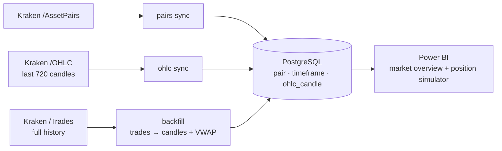

# Crypto Analytics

Data pipeline that collects **Kraken spot market data** into **PostgreSQL** and feeds a **Power BI** report
with a leveraged futures-position simulator (entry/exit point, leverage, direction → P&L and liquidation price).



## Why two ingestion paths?

Kraken's OHLC endpoint only returns the **720 most recent candles** (7.5 days of 15-minute data).
To get a complete history, `backfill` pages through the **raw trade stream** from any start date and
aggregates it locally into OHLCV candles with **VWAP**. `ohlc sync` then keeps the data current cheaply
and warns when a gap is too large for it to fill.

## Highlights

- **Idempotent upserts** – re-running any command is safe; the newest candle (still forming when first
  fetched) is overwritten with its final values, unchanged rows are not rewritten.
- **Exact numbers** – prices and volumes stay `Decimal` end to end (`NUMERIC` in PostgreSQL), never `float`.
- **Resilient API client** – request throttling for Kraken's rate limits, retries with exponential backoff on
  HTTP 429/5xx and Kraken `EAPI:Rate limit` errors.
- **Interrupt-safe backfill** – Ctrl+C flushes everything aggregated so far; the next run resumes.
- **Data-quality check** – `crypto gaps` lists holes in the stored history.
- **Schema migrations** with Alembic, **unit tests** (pytest, mocked HTTP), **ruff**, **GitHub Actions CI**.

## Project layout

```
src/crypto_analytics/
├── cli.py               # `crypto` command (Typer)
├── config.py            # settings from env vars / .env
├── domain.py            # Candle, Trade, Timeframe
├── aggregation.py       # trades → OHLCV + VWAP candles
├── kraken/              # REST client + pure JSON parsers
├── db/                  # SQLAlchemy models, session, repository (all SQL lives here)
└── services/            # sync (pairs, OHLC) and trade backfill
migrations/              # Alembic revisions
tests/                   # pytest
powerbi/                 # Power BI project (PBIP)
```

## Setup

Requires [uv](https://docs.astral.sh/uv/) and PostgreSQL 16+ (or Docker).

```bash
uv sync                          # creates .venv with all dependencies
cp .env.example .env             # adjust CRYPTO_DATABASE_URL if needed
docker compose up -d             # optional: local PostgreSQL
uv run alembic upgrade head      # create / migrate the schema
```

## Usage

```bash
uv run crypto pairs sync                         # register USD pairs listed on Kraken
uv run crypto ohlc sync                          # latest 15m candles for all pairs
uv run crypto ohlc sync XBTUSD ETHUSD -t 1h      # selected pairs, other interval
uv run crypto backfill AAVEUSD --since 2026-06-17   # full history from trades (Ctrl+C safe)
uv run crypto backfill AAVEUSD                   # resume from the last stored candle
uv run crypto gaps XBTUSD --min-missing 4        # data-quality report
```

## Development

```bash
uv run pytest
uv run ruff check .
```

## Data model

| Table | Content |
|---|---|
| `pair` | Kraken pair altname (`XBTUSD`, `ETHUSD`, …) |
| `timeframe` | Interval code and length in seconds (`15m` = 900) |
| `ohlc_candle` | One candle per pair × timeframe × open time: OHLC, volume, VWAP. Check constraints guard OHLC consistency. |
