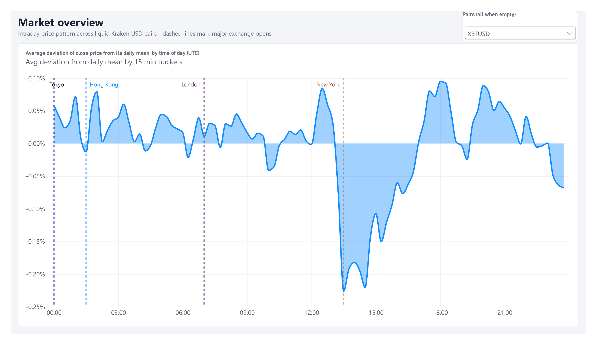
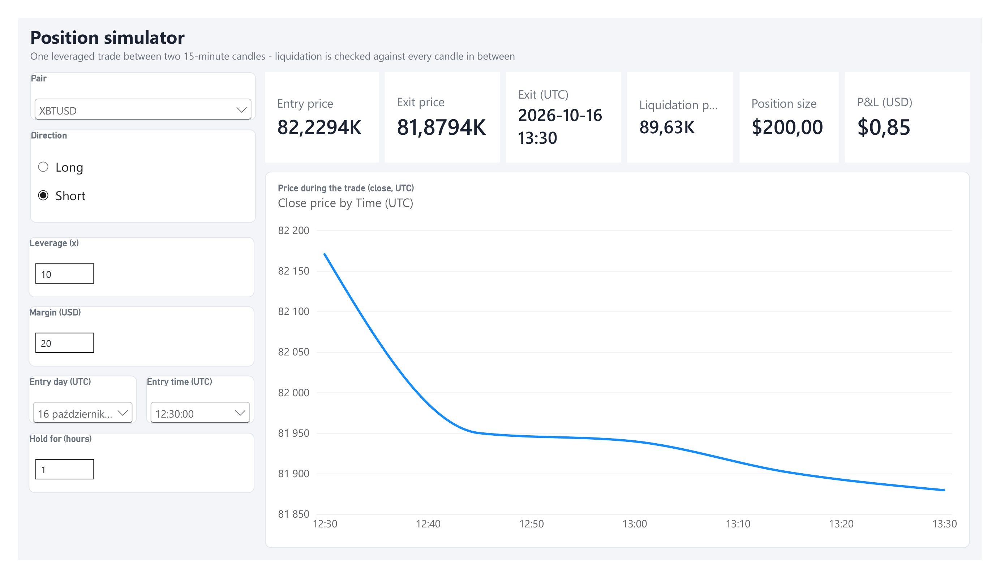
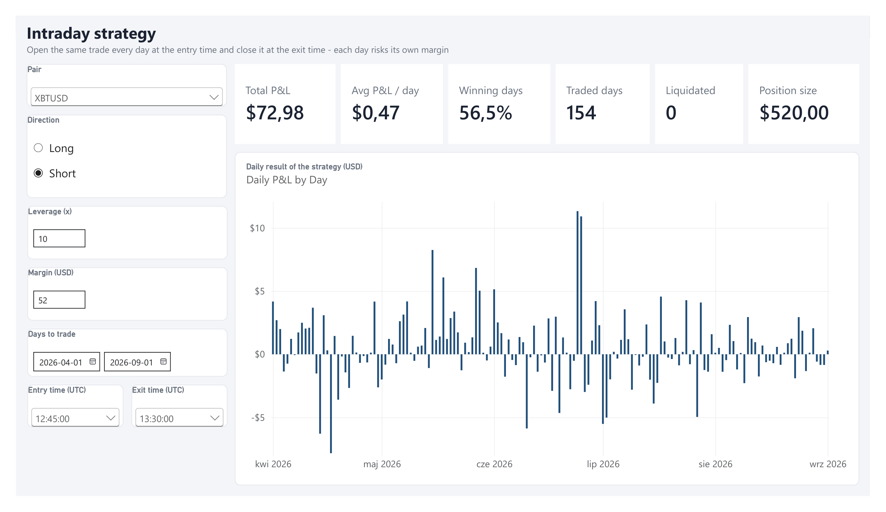
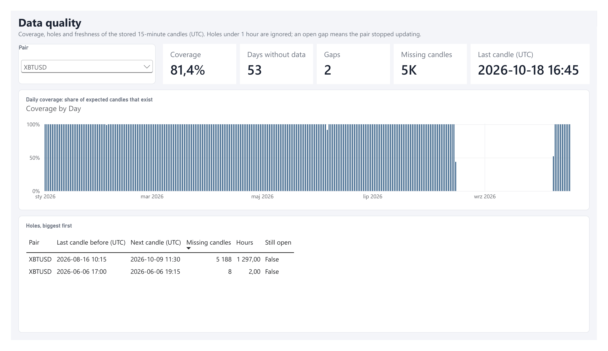
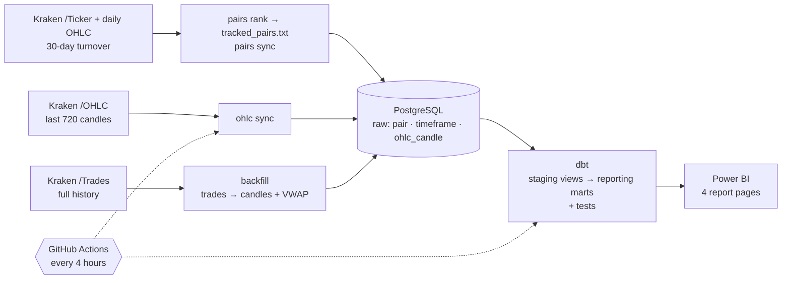

# Crypto Analytics

End-to-end analytics project on **Kraken crypto market data**: a Python pipeline loads 1.5M 15-minute candles
for 323 USD pairs into **PostgreSQL** on a schedule, **dbt** models and tests the reporting layer, a **Power BI**
report explores intraday patterns, simulates leveraged trades and monitors data quality, and **SQL** checks which
of those patterns survive a statistical test.

**Main results:** the US trading session carries over a third of Bitcoin's turnover and roughly double the
volatility of the Asian morning. The "best time of day to buy" visible on the chart is mostly the market's
downtrend, not a real effect. And the best intraday strategy found in Jan–Apr fell apart from May on.
[Key findings ↓](#key-findings)

**Skills shown:** SQL (window functions, CTEs, gaps and islands) · dbt (staging/marts, data and unit tests,
source freshness) · Power BI (DAX, Power Query, star schema, PBIP in Git) · Python (httpx, SQLAlchemy, Typer,
pytest) · GitHub Actions (CI and scheduled loads) · basic inference (t-statistics, train/test split).

| Market overview | Position simulator |
|---|---|
|  |  |
| **Intraday strategy** | **Data quality** |
|  |  |

## Key findings

Times are UTC. XBT (Bitcoin) data runs from 1 Jan to 16 Aug 2026; the cross-pair figures cover 7 Jun – 16 Aug 2026.

1. **Turnover is extremely concentrated.** 10 of 323 pairs account for 84.7% of the $27.0B USD turnover,
   and Bitcoin alone for 27.4%. Stablecoins, FX and tokenised gold (USDT, USDC, EUR, GBP, PAXG) make up 40.7%,
   so a large share of "crypto" volume is really dollar conversion.
2. **The US session drives the market.** From 13:00 to 18:00 UTC (21% of the day), XBT trades 35.6% of its daily
   turnover. The average 15-minute move peaks at 0.235% at 14:00, right after the New York open (13:30), against 0.117% at 10:00.
3. **The "cheapest hour" is mostly trend, not a pattern.** On the overview chart XBT trades above its daily average
   in Asian hours (+0.11% at 01:00) and below it in the US evening (−0.10% at 18:00). But XBT fell 28% over the period
   (−0.15% per day), which alone produces that shape. Tested per hour, no hour's mean return is significantly
   different from zero (largest |t| = 1.87 across 24 hours, 227 days).
4. **Liquidation risk jumps between 10x and 20x leverage.** For a 24-hour XBT position opened at any 15-minute candle,
   2x and 5x were never liquidated. At 10x, 0.7% of longs were liquidated; at 20x, 8.9% (7.6% of shorts). At 20x, a 4% move
   against the position is enough, and that happens regularly. SOL at 20x: about 13% in both directions.
5. **The best intraday strategy is overfitted.** Of 276 "long from hour A to hour B" windows, the best on Jan–Apr
   (19:00 → 23:00: +0.14% per day, 57% winning days) earned only +0.06% with 48% winning days on May–Aug (t = 0.78).
   Even in-sample it was not significant (t = 1.53) once you account for choosing it from 276 candidates, and either
   figure is below a typical round-trip fee on perpetual futures (~0.1%).

**So what:** the time-of-day structure that holds up is about *risk*, not *direction*. Volatility and liquidity are
predictable by session, which matters for sizing, stops and leverage. The direction of price over the day is not.

### Data quality and caveats

- **Collection gaps:** all pairs have holes from 27 Jun to 19 Jul and from 16 Aug to 9 Oct 2026, found with `crypto gaps`.
  The findings use only gap-free windows (any entry without 24 hours of continuous data is skipped).
- **Survivorship bias:** the report keeps only the 50 pairs that were most traded in the 30 days to 18 Oct 2026
  (and had at least $1M turnover in the 365-day window), so pairs that faded or died earlier are missing.
- **Simulator assumptions:** isolated margin, 1% maintenance margin, no fees, funding or slippage. Prices are
  spot candles used as a proxy for futures.
- **Session times:** London and New York opens use summer time (07:00 and 13:30 UTC).

## How it works



### Scheduled sync

`.github/workflows/sync.yml` runs every 4 hours: migrations, `pairs sync`, `ohlc sync`, `dbt build`, and a dbt
source-freshness check that fails the run (and emails you) when the newest candle is over 24 hours old. It reads
the database URL from the `CRYPTO_DATABASE_URL` repository secret and the pairs to track
from `tracked_pairs.txt`. `scripts/copy_to_cloud.py` seeds a hosted database with the top pairs by turnover.

### Which pairs are tracked

Kraken lists 600+ USD pairs, most of them barely traded. The pipeline follows a fixed whitelist of the **50 most
traded crypto pairs**, committed as [`tracked_pairs.txt`](tracked_pairs.txt) and stored in `pair.tracked`.
`crypto pairs rank` builds it: one `/Ticker` call gives the 24-hour turnover of every pair, the 150 busiest become a
shortlist, and their daily candles rank them by **30-day** USD turnover, since a single day is too noisy. Fiat and
tokenised gold are excluded by name (`CRYPTO_EXCLUDED_BASES`); USD stablecoins are detected from their price
(within 2% of $1 and less than 1% daily range), so new ones need no list update.

The list is fixed on purpose. Re-ranking on every run would make pairs near the cut-off drop out and come back,
leaving holes in their history each time. The scheduled `pairs sync` only applies the file; `ohlc sync` and the
dbt `pairs` mart use tracked pairs only, and `crypto pairs prune` deletes the rest.

### dbt reporting layer

`dbt/` turns the raw tables into what Power BI reads: `staging` views (cleaned, UTC) and `reporting` marts —
`pairs`, `candles_15m`, `data_gaps` and `daily_coverage`. 23 data tests and 3 unit tests run on every build.
Run it with `uv run crypto dbt build`; the wrapper passes `CRYPTO_DATABASE_URL` to dbt, so there is one setting.
It uses dbt Core 1.12, because dbt v2 does not support PostgreSQL yet.

### Why two ingestion paths?

Kraken's OHLC endpoint only returns the **720 most recent candles** (7.5 days of 15-minute data).
To get a complete history, `backfill` pages through the **raw trade stream** from any start date and
aggregates it locally into OHLCV candles with **VWAP**. `ohlc sync` then keeps the data current cheaply
and warns when a gap is too large for it to fill.

## Highlights

- **Idempotent upserts** – re-running any command is safe; the newest candle (still forming when first
  fetched) is overwritten with its final values, unchanged rows are not rewritten.
- **Exact numbers** – prices and volumes stay `Decimal` end to end (`NUMERIC` in PostgreSQL), never `float`.
- **Resilient API client** – request throttling for Kraken's rate limits, retries with exponential backoff on
  HTTP 429/5xx and Kraken `EAPI:Rate limit` errors.
- **Interrupt-safe backfill** – Ctrl+C flushes everything aggregated so far; the next run resumes.
- **Backfill fetches only holes** – candles already stored are skipped (every 1000 trades cost an API call), so
  re-running over a long window only downloads what is missing; `--overwrite` rebuilds everything. A progress
  bar shows how far it got and the time left.
- **Data-quality checks** – `crypto gaps` ranks every pair by missing data (or lists one pair's holes with
  the `backfill` command to fill them); dbt tests and freshness checks run on every scheduled load.
- **Schema migrations** with Alembic, **unit tests** (pytest, mocked HTTP), **ruff**, **GitHub Actions CI**.

## Project layout

```
src/crypto_analytics/
├── cli.py               # `crypto` command (Typer)
├── config.py            # settings from env vars / .env
├── domain.py            # Candle, Trade, Timeframe
├── aggregation.py       # trades → OHLCV + VWAP candles
├── kraken/              # REST client + pure JSON parsers
├── db/                  # SQLAlchemy models, session, repository (all SQL lives here)
└── services/            # sync (pairs, OHLC) and trade backfill
migrations/              # Alembic revisions (raw tables)
dbt/                     # dbt project: staging views, reporting marts, tests
tests/                   # pytest
scripts/copy_to_cloud.py # one-off: seed a hosted database with the top pairs
powerbi/                 # Power BI project (PBIP)
docs/img/                # report screenshots
```

## Setup

Requires [uv](https://docs.astral.sh/uv/) and PostgreSQL 16+ (or Docker).

```bash
uv sync                          # creates .venv with all dependencies (incl. dbt)
cp .env.example .env             # adjust CRYPTO_DATABASE_URL if needed
docker compose up -d             # optional: local PostgreSQL
uv run alembic upgrade head      # create / migrate the raw tables
uv run crypto dbt build          # build and test the reporting layer
```

## Usage

```bash
uv run crypto pairs rank --top 50 --days 30      # rank by 30-day turnover, rewrite tracked_pairs.txt
uv run crypto pairs sync                         # apply tracked_pairs.txt to the database
uv run crypto pairs prune                        # list untracked pairs; --yes deletes them and their candles
uv run crypto ohlc sync                          # latest 15m candles for tracked pairs
uv run crypto ohlc sync XBTUSD ETHUSD -t 1h      # selected pairs, other interval
uv run crypto backfill AAVEUSD --since 2026-06-17   # full history from trades (Ctrl+C safe)
uv run crypto backfill AAVEUSD                   # fill the first gap too large for ohlc sync, or resume
uv run crypto backfill --since 2026-08-16 --until 2026-10-12   # one window for every tracked pair
uv run crypto gaps                               # every pair ranked by missing candles
uv run crypto gaps XBTUSD --since 2026-06-01     # one pair's holes (UTC) + the backfill command to fill them
uv run crypto dbt build                          # rebuild and test the reporting tables
uv run crypto dbt source freshness               # is the newest candle recent enough?
uv run crypto dbt docs generate && uv run crypto dbt docs serve   # model docs + lineage graph
```

## Development

```bash
uv run pytest
uv run ruff check .
uv run crypto dbt build    # dbt unit tests + data tests
```

## Power BI report

`powerbi/crypto_analysis.pbip` (Power BI Project – model in TMDL, report in PBIR, both plain text in Git).
It imports the dbt marts in the `reporting` schema, which already apply the top-50 whitelist, the 365-day
window, the 1M USD liquidity filter and UTC conversion, so the report itself stays thin: a star schema with three
fact tables (candles, gaps, daily coverage) sharing the pair and calendar dimensions. The connection is set by two
Power Query parameters, `DatabaseServer` (default `localhost:5432`) and `DatabaseName`
(Transform data → Edit parameters).

| Page | What it shows |
|---|---|
| **Market overview** | Average deviation of the close from its daily mean by time of day (UTC), with Tokyo / Hong Kong / London / New York opens. |
| **Position simulator** | One leveraged long/short trade between two candles: entry/exit price, position size, liquidation price and P&L. Liquidation is checked against the low/high of every candle in between. |
| **Intraday strategy** | The same trade repeated every day at fixed entry/exit times: total and average daily P&L, winning-day ratio, liquidated days, daily P&L chart. |
| **Data quality** | For one pair: coverage of expected candles per day, number and size of holes, days without data, newest candle. |

Assumptions: isolated margin, 1% maintenance margin rate (`Maintenance Margin Rate` measure), no fees or funding.

## Data model

| Table | Content |
|---|---|
| `pair` | Kraken pair altname (`XBTUSD`, `ETHUSD`, …) and whether it is on the tracked whitelist |
| `timeframe` | Interval code and length in seconds (`15m` = 900) |
| `ohlc_candle` | One candle per pair × timeframe × open time: OHLC, volume, VWAP. Check constraints guard OHLC consistency. |

## License

[MIT](LICENSE)
