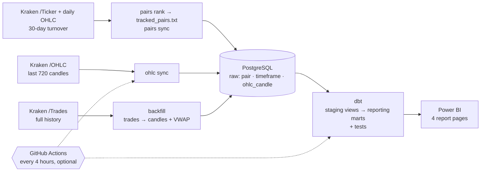

# Crypto Analytics

End-to-end analytics project on **Kraken crypto market data**: a Python pipeline loads 15-minute candles
for the 50 most traded USD crypto pairs into **PostgreSQL**, **dbt** models and tests the reporting layer, and a
**Power BI** report explores intraday patterns, simulates leveraged trades and monitors data quality.

**Skills shown:** SQL (window functions, CTEs, gaps and islands) · dbt (staging/marts, data and unit tests,
source freshness) · Power BI (DAX, Power Query, star schema, PBIP in Git) · Python (httpx, SQLAlchemy, Typer,
pytest) · GitHub Actions (CI and a scheduled sync workflow).

| Market overview | Position simulator |
|---|---|
|  |  |
| **Intraday strategy** | **Data quality** |
|  |  |

### Data quality and caveats

- **Collection gaps:** collection paused from 27 Jun to 19 Jul and from 16 Aug to 9 Oct 2026, longer than the
  7.5 days `ohlc sync` can recover. XBT has been rebuilt from trades as the worked example: since 1 Jun it went from
  5,196 missing 15-minute candles to none (100% daily coverage). The other 49 pairs still miss 7,441 candles each,
  which the Data quality page shows (ETH, for instance, averages 42% daily coverage since 1 Jun). Filling them is
  one command, `crypto backfill --since 2026-06-01`, and about 10 hours of API calls (see below).
- **Survivorship bias:** the report keeps only the 50 pairs that were most traded in the 30 days to 18 Oct 2026
  (and had at least $1M turnover in the 365-day window), so pairs that faded or died earlier are missing.
- **Simulator assumptions:** isolated margin, 1% maintenance margin, no fees, funding or slippage. Prices are
  spot candles used as a proxy for futures.
- **Session times:** London and New York opens use summer time (07:00 and 13:30 UTC).

## How it works



### Scheduled sync

The project runs against a local database. `scripts/register_sync_task.ps1` registers a Windows scheduled task
that runs `scripts/sync_local.ps1` every 4 hours (`ohlc sync`, then `dbt build`, logged to `logs/sync.log`);
runs missed while the computer was off start when it is back. For a hosted database, `.github/workflows/sync.yml` is ready to
run every 4 hours: migrations, `pairs sync`, `ohlc sync`, `dbt build`, and a dbt source-freshness check that fails
the run (and emails you) when the newest candle is over 24 hours old. It is off by default; to turn it on, add the
database URL as the `CRYPTO_DATABASE_URL` repository secret and set the repository variable `SYNC_ENABLED` to
`true`. `scripts/copy_to_cloud.py` seeds the hosted database with the top pairs by turnover.

### Which pairs are tracked

Kraken lists 600+ USD pairs, most of them barely traded. The pipeline follows a fixed whitelist of the **50 most
traded crypto pairs**, committed as [`tracked_pairs.txt`](tracked_pairs.txt) and stored in `pair.tracked`.
`crypto pairs rank` builds it: one `/Ticker` call gives the 24-hour turnover of every pair, the 150 busiest become a
shortlist, and their daily candles rank them by **30-day** USD turnover, since a single day is too noisy. Fiat and
tokenised gold are excluded by name (`CRYPTO_EXCLUDED_BASES`); USD stablecoins are detected from their price
(within 2% of $1 and less than 1% daily range), so new ones need no list update.

The list is fixed on purpose. Re-ranking on every run would make pairs near the cut-off drop out and come back,
leaving holes in their history each time. `pairs sync` only applies the file; `ohlc sync` and the
dbt `pairs` mart use tracked pairs only, and `crypto pairs prune` deletes the rest.

### dbt reporting layer

`dbt/` turns the raw tables into what Power BI reads: `staging` views (cleaned, UTC) and `reporting` marts —
`pairs`, `candles_15m`, `data_gaps` and `daily_coverage`. 23 data tests and 3 unit tests run on every build.
Run it with `uv run crypto dbt build`; the wrapper passes `CRYPTO_DATABASE_URL` to dbt, so there is one setting.
It uses dbt Core 1.12, because dbt v2 does not support PostgreSQL yet.

### Kraken API limits and how the pipeline handles them

| Problem | What it means | How it is handled |
|---|---|---|
| **`/OHLC` returns only the last 720 candles** | 7.5 days of 15-minute data. Any pause in collection longer than that leaves a hole the endpoint can never fill. | `backfill` rebuilds history from the raw trade stream (`/Trades`), which reaches back to a pair's first trade, and aggregates it locally into OHLCV candles with VWAP. `ohlc sync` warns when a gap is too big for it, and `crypto gaps` lists every hole with the command to fill it. |
| **`/Trades` returns at most 1000 trades per request** | XBT alone trades about 100,000 times a day, so one day of history costs ~100 requests. | Backfill skips candles already stored and jumps straight to the missing stretches, so re-running a long window only downloads the holes. |
| **Public rate limit of about 1 request per second** | The 54-day XBT hole took ~5,000 requests, roughly 1.5 hours; both holes for all 50 pairs take about 10 hours. | Requests are throttled to 1 per second, with exponential backoff on HTTP 429/5xx and `EAPI:Rate limit`. Backfill writes every ~3 weeks of candles and on Ctrl+C, so a long run can be stopped and resumed, and a progress bar shows time left. |
| **The newest candle is still forming** | The last candle from `/OHLC` changes until its 15 minutes are over. | Each sync re-requests the last stored candle and upserts it; unchanged rows are not rewritten. |
| **Placeholder candles at time 0** | Freshly listed pairs can return a candle stamped 1970-01-01. | The parser skips them and a check constraint rejects any candle before 2013. |
| **600+ USD pairs, most barely traded** | Plus stablecoins and fiat that would crowd the top of a turnover ranking. | A fixed whitelist of the 50 most traded crypto pairs ([above](#which-pairs-are-tracked)). |

## Highlights

- **Idempotent upserts** – re-running any command is safe; the newest candle (still forming when first
  fetched) is overwritten with its final values, unchanged rows are not rewritten.
- **Exact numbers** – prices and volumes stay `Decimal` end to end (`NUMERIC` in PostgreSQL), never `float`.
- **Data-quality checks** – `crypto gaps` ranks every pair by missing data (or lists one pair's holes with
  the `backfill` command to fill them); dbt tests and freshness checks run on every build.
- **Schema migrations** with Alembic, **unit tests** (pytest, mocked HTTP), **ruff**, **GitHub Actions CI**.

## Project layout

```
src/crypto_analytics/
├── cli.py               # `crypto` command (Typer)
├── config.py            # settings from env vars / .env
├── domain.py            # Candle, Trade, Timeframe
├── aggregation.py       # trades → OHLCV + VWAP candles
├── kraken/              # REST client + pure JSON parsers
├── db/                  # SQLAlchemy models, session, repository (all SQL lives here)
└── services/            # sync (pairs, OHLC) and trade backfill
migrations/              # Alembic revisions (raw tables)
dbt/                     # dbt project: staging views, reporting marts, tests
tests/                   # pytest
scripts/                # Windows sync task, seeding a hosted database
powerbi/                 # Power BI project (PBIP)
docs/img/                # report screenshots
```

## Setup

Requires [uv](https://docs.astral.sh/uv/) and PostgreSQL 16+ (or Docker).

```bash
uv sync                          # creates .venv with all dependencies (incl. dbt)
cp .env.example .env             # adjust CRYPTO_DATABASE_URL if needed
docker compose up -d             # optional: local PostgreSQL
uv run alembic upgrade head      # create / migrate the raw tables
uv run crypto dbt build          # build and test the reporting layer
```

## Usage

```bash
uv run crypto pairs rank --top 50 --days 30      # rank by 30-day turnover, rewrite tracked_pairs.txt
uv run crypto pairs sync                         # apply tracked_pairs.txt to the database
uv run crypto pairs prune                        # list untracked pairs; --yes deletes them and their candles
uv run crypto ohlc sync                          # latest 15m candles for tracked pairs
uv run crypto ohlc sync XBTUSD ETHUSD -t 1h      # selected pairs, other interval
uv run crypto backfill AAVEUSD --since 2026-06-17   # full history from trades (Ctrl+C safe)
uv run crypto backfill AAVEUSD                   # fill the first gap too large for ohlc sync, or resume
uv run crypto backfill --since 2026-08-16 --until 2026-10-12   # one window for every tracked pair
uv run crypto gaps                               # every pair ranked by missing candles
uv run crypto gaps XBTUSD --since 2026-06-01     # one pair's holes (UTC) + the backfill command to fill them
uv run crypto dbt build                          # rebuild and test the reporting tables
uv run crypto dbt source freshness               # is the newest candle recent enough?
uv run crypto dbt docs generate && uv run crypto dbt docs serve   # model docs + lineage graph
```

## Development

```bash
uv run pytest
uv run ruff check .
uv run crypto dbt build    # dbt unit tests + data tests
```

## Power BI report

`powerbi/crypto_analysis.pbip` (Power BI Project – model in TMDL, report in PBIR, both plain text in Git).
It imports the dbt marts in the `reporting` schema, which already apply the top-50 whitelist, the 365-day
window, the 1M USD liquidity filter and UTC conversion, so the report itself stays thin: a star schema with three
fact tables (candles, gaps, daily coverage) sharing the pair and calendar dimensions. The connection is set by two
Power Query parameters, `DatabaseServer` (default `localhost:5432`) and `DatabaseName`
(Transform data → Edit parameters).

| Page | What it shows |
|---|---|
| **Market overview** | Average deviation of the close from its daily mean by time of day (UTC), with Tokyo / Hong Kong / London / New York opens. |
| **Position simulator** | One leveraged long/short trade between two candles: entry/exit price, position size, liquidation price and P&L. Liquidation is checked against the low/high of every candle in between. |
| **Intraday strategy** | The same trade repeated every day at fixed entry/exit times: total and average daily P&L, winning-day ratio, liquidated days, daily P&L chart. |
| **Data quality** | For one pair: coverage of expected candles per day, number and size of holes, days without data, newest candle. |

Assumptions: isolated margin, 1% maintenance margin rate (`Maintenance Margin Rate` measure), no fees or funding.

## Data model

| Table | Content |
|---|---|
| `pair` | Kraken pair altname (`XBTUSD`, `ETHUSD`, …) and whether it is on the tracked whitelist |
| `timeframe` | Interval code and length in seconds (`15m` = 900) |
| `ohlc_candle` | One candle per pair × timeframe × open time: OHLC, volume, VWAP. Check constraints guard OHLC consistency. |

## License

[MIT](LICENSE)
